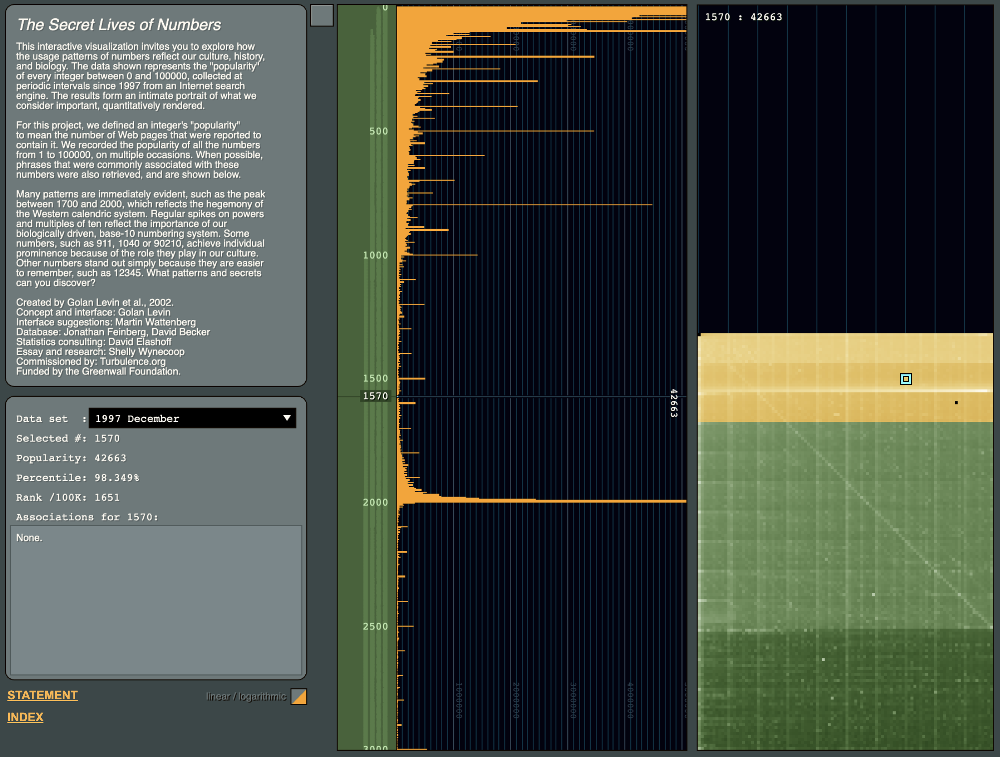
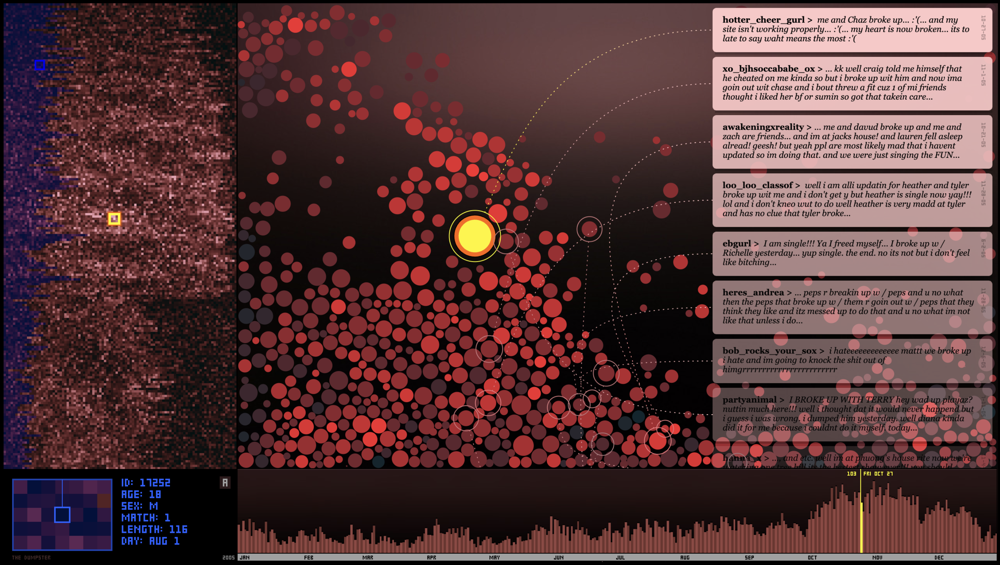
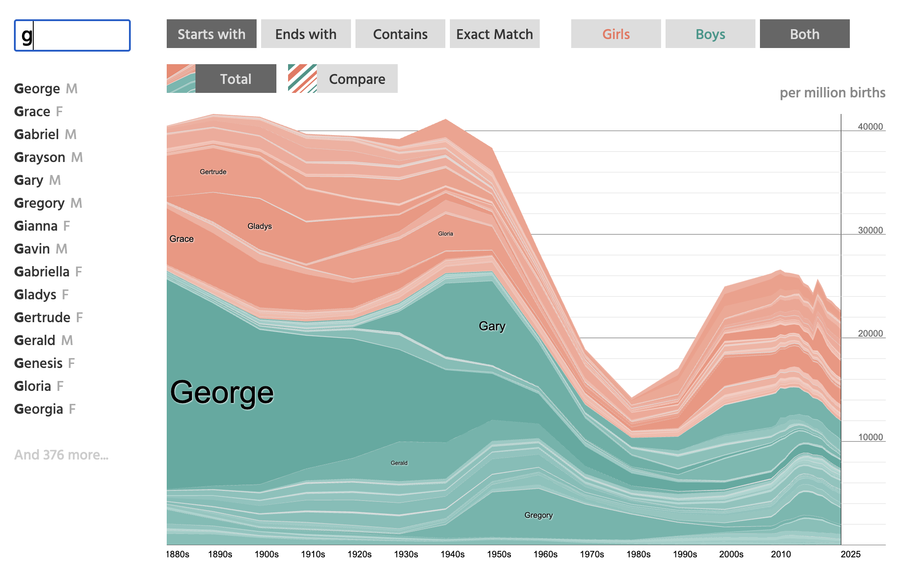
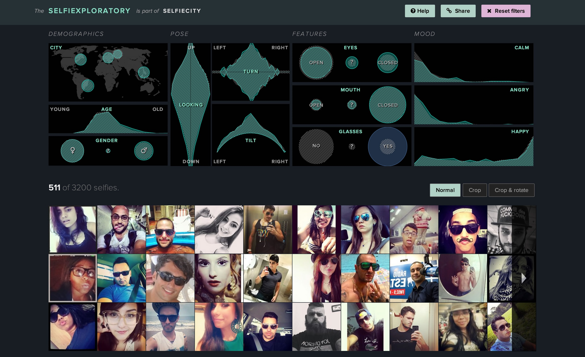
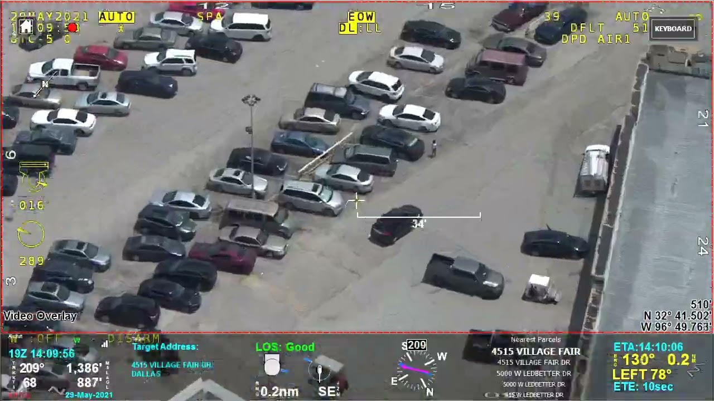
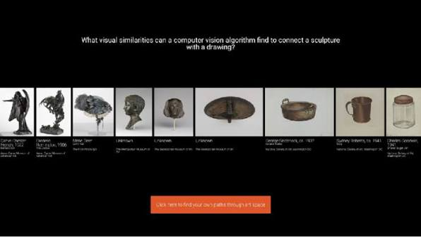
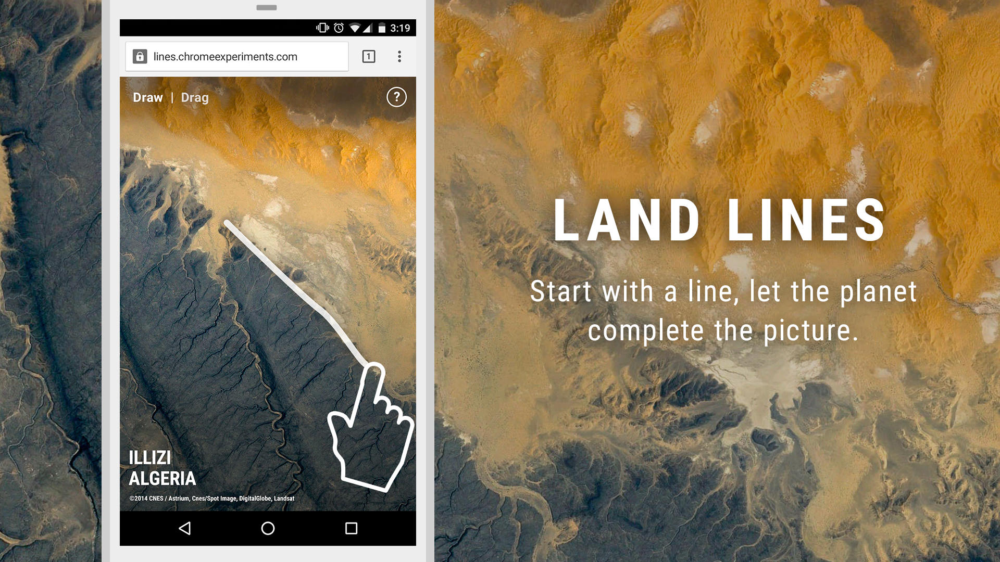
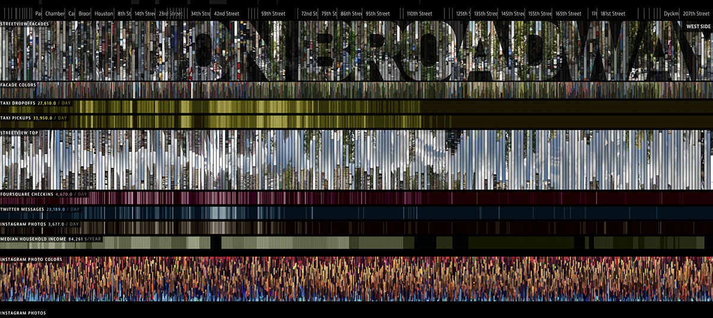
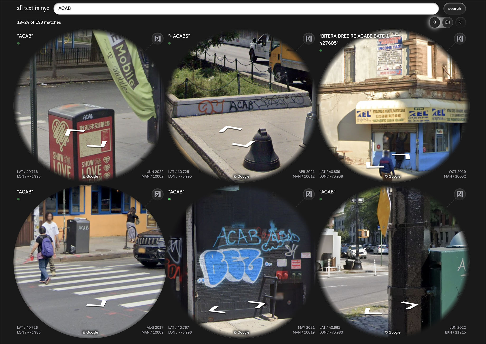

# Data Arts & Other Creative Coding Practices

Presentation in "Creative Coding", NYU IDM, November 19, 2026

Today's Technical Takeaway

* zoom 
* sort 
* filter 
* query

Tips: 

* an unusual dataset
* an inventive interaction paradigm
* an unexpected mapping between data and experience 
* a critical position toward the systems producing the data

<!-- Rutherford Chang -->

---

* Golan Levin et al., [*The Secret Lives of Numbers*](https://golanlevin.github.io/slon/index.html) (1997-2002)

* Golan Levin et al., [*The Dumpster*](https://golanlevin.github.io/dumpster/index.html) (2006)

---

* Laura & Martin Wattenberg, [*NameGrapher* (Baby Name Voyager)](https://namerology.com/baby-name-grapher/)

* Lev Manovich, [*Selfiecity*](https://selfiecity.net/selfiexploratory/) (2014) 
An examination of Instagram selfies as a form of contemporary visual culture.

---

**Cassandra C. Jones, [*Eventide*](https://vimeo.com/10102702)** (2004) 
A five-minute video that meticulously aligns and sequences 1,391 photographs of sunsets, taken by different people around the world, to create the illusion of a single, continuous sunset. 

**Sam Lavigne, [*The Zooms*](https://www.youtube.com/watch?v=Xf9V-RNjXlg)** (2022) 
“In November of 2021, an anonymous source leaked 600 hours of police aerial surveillance footage to the non-profit transparency organization Distributed Denial of Secrets. [...] I wrote a script that analyzed all 600 hours of footage, and automatically re-cut it to only include shots where the camera zooms in.” 

**Mario Klingemann, [*X Degrees of Separation*](https://artsexperiments.withgoogle.com/xdegrees/8gHu5Z5RF4BsNg/BgHD_Fxb-V_K3A)** (2018) 

* **Zach Lieberman, [*LandLines*](https://lines.chromeexperiments.com/)** (2018) 
Lets users explore real Google Earth satellite imagery through simple drawing and dragging gestures

* **Manovich, Stefaner, et al, [*On Broadway*](https://on-broadway.nyc/app/#)** (2014) 
A visual cross-section of Manhattan constructed from Instagram, Street View, taxi activity, income data, and other sources. Thirteen aligned layers replace the conventional map.

* **Yufeng Zhao, [*All Text In NYC*](https://alltext.nyc/)** (2024) 
"all text in nyc" is a map of visible text in New York City, extracted from Google Street View images. Search for any word or phrase to see where it appears across the city—in shop signs, graffiti, advertisements, and protest signs. Using optical character recognition, the project turns Street View documentation into an exploration tool. There are 565 “best pizza” spots in NYC!

---

Golan Levin, [Cytographia](https://golanlevin.github.io/cytographia/index.html) (2021)

[Interpolation](https://github.com/golanlevin/interpolation_sketchbook/blob/main/README.md)

